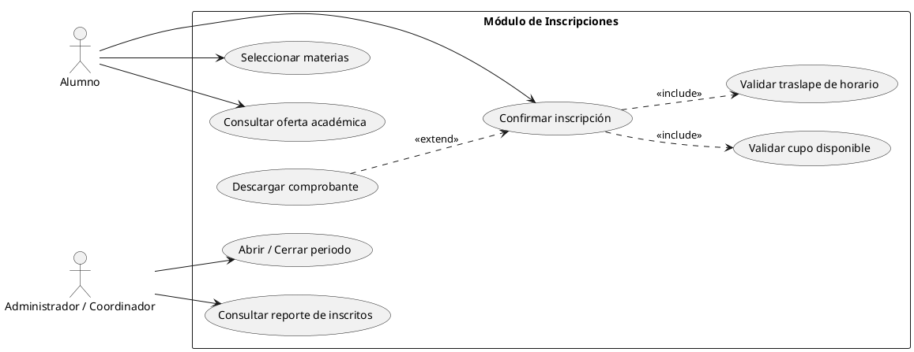
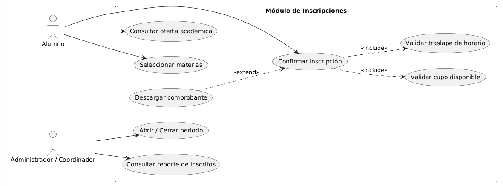

# Modulo Inscripciones

> Equipo 2
>
> Autor: Santiago Cuevas Sánchez

## Resumen

El módulo de Inscripciones permite a los alumnos consultar la oferta académica, seleccionar las materias que cursarán y confirmar su inscripción dentro de un periodo. También permite al personal administrativo controlar el periodo de inscripción y consultar quiénes se han inscrito.

## Objetivo y Alcance

**Objetivo:** gestionar el proceso de inscripción de los alumnos a las materias de un periodo, garantizando que se respeten el cupo y los horarios.

**Alcance:**

- Incluye: consulta de oferta académica, selección de materias, confirmación de inscripción con validaciones, descarga de comprobante, reporte de inscritos y apertura/cierre del periodo de inscripción.
- No incluye: la creación y configuración de periodos escolares (módulo Periodo) ni la captura de calificaciones.

## Requerimientos funcionales

| ID | Requerimiento | Actor |
|----|---------------|-------|
| RF-01 | El sistema debe permitir consultar la oferta académica disponible. | Alumno |
| RF-02 | El sistema debe permitir seleccionar materias de la oferta académica. | Alumno |
| RF-03 | El sistema debe permitir confirmar la inscripción de las materias seleccionadas. | Alumno |
| RF-04 | Al confirmar, el sistema debe validar que exista cupo disponible. | Sistema (include) |
| RF-05 | Al confirmar, el sistema debe validar que no haya traslape de horario. | Sistema (include) |
| RF-06 | El sistema debe permitir descargar un comprobante de inscripción. | Alumno (extend) |
| RF-07 | El sistema debe permitir consultar el reporte de alumnos inscritos. | Administrador / Coordinador |
| RF-08 | El sistema debe permitir abrir y cerrar el periodo de inscripción. | Administrador / Coordinador |

## Actores

| Actor | Descripción | Acciones principales |
|-------|-------------|----------------------|
| Alumno | Estudiante que se inscribe a materias. | Consultar oferta académica, seleccionar materias, confirmar inscripción, descargar comprobante. |
| Administrador / Coordinador | Personal encargado de controlar el proceso de inscripción. | Consultar reporte de inscritos, abrir / cerrar periodo. |

## Diagrama de casos de uso

### Código fuente

### Imagen

## Glosario y Abreviaturas

| Término | Definición |
|---------|------------|
| Inscripción | Registro formal de un alumno en las materias de un periodo. |
| Oferta académica | Conjunto de materias disponibles para cursar en un periodo. |
| Cupo | Número máximo de alumnos que pueden inscribirse a una materia. |
| Traslape de horario | Coincidencia de horas entre dos materias que el alumno quiere cursar. |
| Comprobante | Documento que confirma las materias inscritas por el alumno. |
| `<<include>>` | Relación en la que un caso de uso siempre ejecuta a otro. |
| `<<extend>>` | Relación en la que un caso de uso agrega comportamiento opcional a otro. |

## Requerimientos No funcionales

| ID | Requerimiento |
|----|---------------|
| RNF-01 | Solo los alumnos con sesión iniciada pueden inscribirse; solo el personal autorizado puede abrir/cerrar periodos y ver reportes. |
| RNF-02 | La validación de cupo debe evitar que dos alumnos ocupen el último lugar al mismo tiempo. |
| RNF-03 | La confirmación de inscripción debe responder en un tiempo razonable (por ejemplo, menos de 5 segundos). |
| RNF-04 | La interfaz debe poder usarse desde navegador en computadora y celular. |
